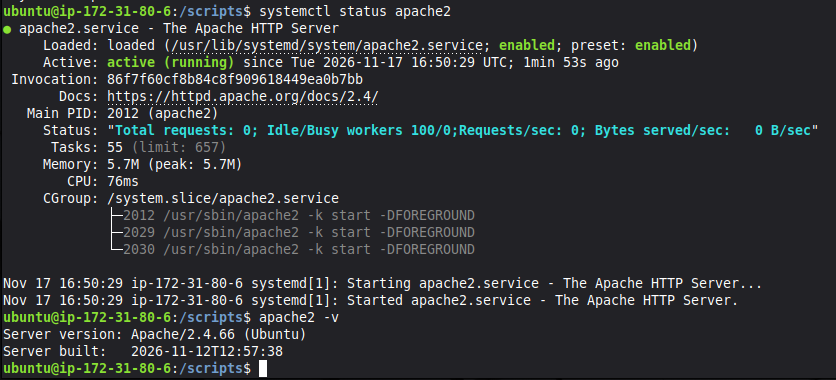
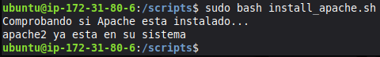
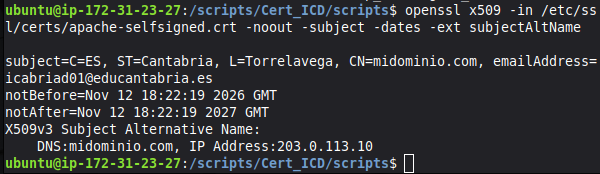
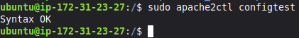
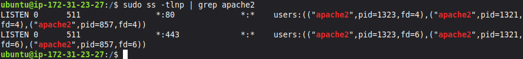
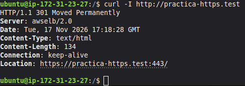
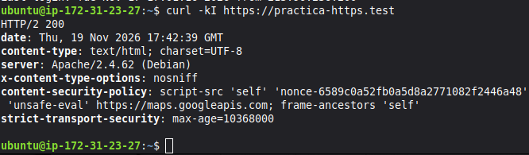
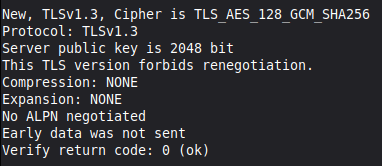
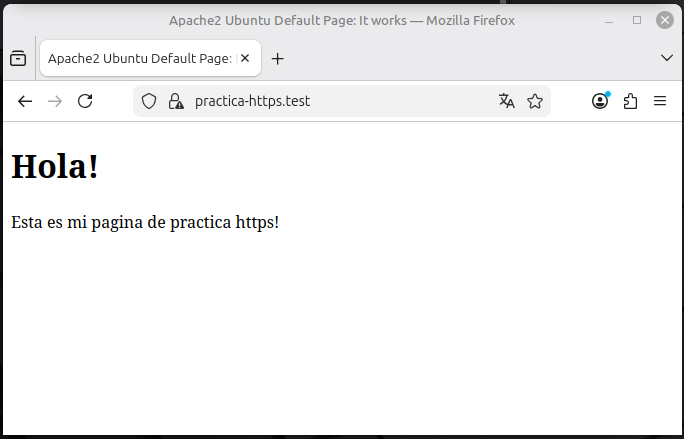

# Certificados SSL de Isaac Cabria Diez

Aqui saldran capturas de pantalla mostrando 
los resultados esperados sobre los certificados creados en 9 pasos

## 1.- Instalacion de apache
Aqui esta la ejecucion del script install_apache.sh, correctamente instalado

Comando: `sudo bash install.sh`

se ha realizado un status y version para verificar su correcta instalación

## 2.- Reejecucion del script de instalacion
Al ejecutar el script otra vez, si Apache ya esta previamente instalado, mostrará un mensaje de aviso de que ya esta instalado:

## 3.- Sujeto, validez y SAN del certificado
Para la verificacion del certificado que he hecho he realizado el siguiente comando:

`openssl x509 -in /etc/ssl/certs/apache-selfsigned.crt -noout -subject -dates -ext subjectAltName`

(Los datos mostrados en la captura son usados de ejemplo)

## 4.- Sintaxis de Apache
La configuración de apache esta bien realizada, para verificarlo ejecuto `sudo apache2ctl configtest` y verifico que muestre "Syntax OK"

## 5.- Puertos a la escucha
Los puertos de escucha que estan abiertos son los siguientes:

80: Para Protocolo **HTTP**.

443: Para Protocolo **HTTPS**.

## 6.- Redireccion HTTP → HTTPS
Al realizar la redireccion de http a https con el comando: `curl -I http://practica-https.test`nos da el siguiente resultado:

## 7.- Respuesta HTTPS
Despues de realizar la dirección, al hacer el comando: `curl -kI https://practica-https.test` obtendremos un resultado de HTTP/1.1 200, indicando que funciona correctamente

## 8.- Negociacion TLS
para revisar las negociaciones TLS como su version, cifrado y certificado presentado se hace el comando `openssl s_client -connect practica-https.test:443 -servername practica-https.test < /dev/null`
debajo del certificado que se muestra al ejecutar el comando muestra la version y los demas detalles

## 9.- Navegador
Al verificar que el Virtualhost, el certificado, y todo lo demas esta correctamente hecho, vamos al navegador web y ponemos la dirección https://practica-https.test (Teniendo en cuenta que la direccion IP esta escrita en el archivo hosts)

Nos saldrá un aviso de certificado no confiable, pero se puede ignorar yendo a configuracion Avanzada -> acceder igualmente

